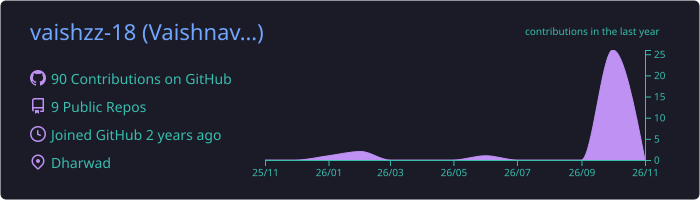
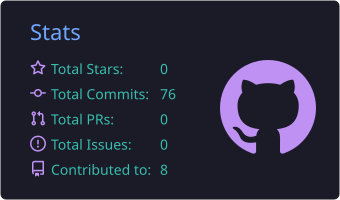
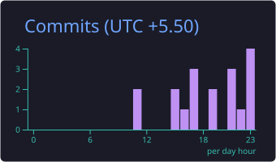
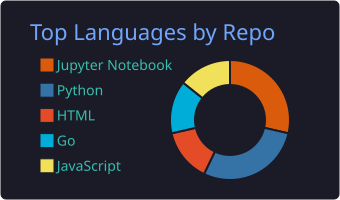
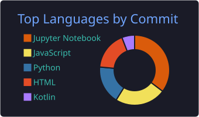

### Hey there! I'm Vaishnavi 👋

 

---

## 👩‍💻 About Me

I'm a technology enthusiast passionate about Artificial Intelligence, software development, and exploring emerging technologies.

- 🧠 Interested in Artificial Intelligence, Machine Learning and Generative AI.
- 🤖 Exploring LLMs, Agentic AI, RAG and intelligent automation.
- 👁️ Fascinated by Computer Vision and Deep Learning.
- 💻 Enjoy building applications and experimenting with new technologies.
- 🔬 Interested in research-driven development and problem-solving.
- 🌱 Always curious to learn, experiment and grow.

**My philosophy:** Learn deeply. Build boldly. Keep improving.

---

## 🛠️ Tech Stack & Tools

### Programming Languages

### AI / ML / Data Science

### Web Development & Backend

### Tools & Platforms

---

## 📊 GitHub Statistics

  

  
  

  
  

---

## 🤝 Let's Connect!

I'm always happy to connect with people passionate about technology, AI, research and innovation.

  

### ✨ Thanks for stopping by!

*Curiosity drives me. Technology inspires me. Learning never stops.*

